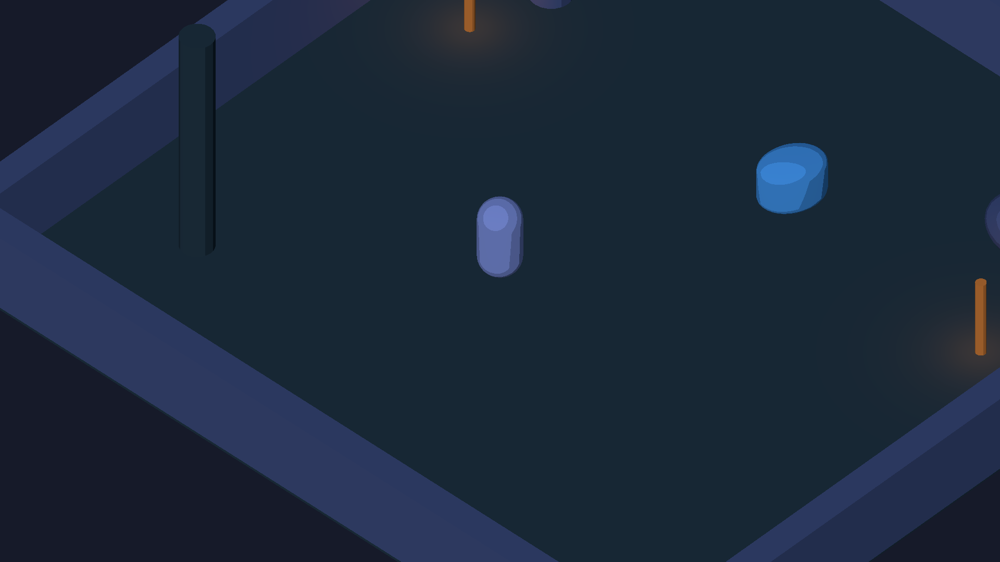

# Sprint 01 — evidências e limites

Data: 19/10/2026. Branch: `feat/sprint01-playable-foundation`.

Base: `acd8b49822f77f1ec2ba617850d66bf9768db35c`, head do PR #2, que contém o PR #1 (`1d09c320b11f8655b6440fe124c05a7fbf80e89c`). Ambos estavam abertos; #1 em draft. Nenhum merge realizado. Somente o checkout do repositório **Echoes-of-Aethel-v2** foi modificado. Nenhum código/asset da v1 foi importado.

## Ambiente e configuração

- Unity **6000.6.6f1** (`d20c9ac777da`), Windows x64.
- Template oficial instalado: `com.unity.template.urp-blank-17.2.6.tgz`; importados ProjectSettings, Packages e Assets/Settings, sem a cena de exemplo.
- URP **17.6.0**, Input System **1.20.0**, Test Framework **1.8.0**, versões fixadas no manifest/lock. Nenhum caminho local/tarball de diagnóstico é necessário no manifest de entrega.
- Windows: Mono, D3D11, Forward, 1920×1080, perfil PC, VSync 1; sombras direcionais com distância 30 m, duas cascatas e atlas 1024. Não há garantia de FPS nesta sprint.
- Hardware reportado pelo executável: **Intel Xeon E5-2630 v3 @ 2.40 GHz; AMD Radeon RX 580 2048SP; 16224 MB de RAM**.
- Durante o diagnóstico inicial foi usado cache UPM isolado em Library e `-burst-disable-compilation`. O build Windows final e a reabertura final foram executados **sem** essa flag. O cache é temporário e ignorado pelo Git.

## Problemas corrigidos e comportamento preservado

1. Lobo recebia gravidade somente enquanto perseguia: gravidade agora independe de chase/windup/recovery/morte.
2. Câmera recalculava LookAt durante o smoothing, mudando a base do movimento: orientação isométrica permanece fixa e a posição acompanha o jogador; referência é restaurada na abertura.
3. Origem/pivô dos personagens não estava preparada para rig: os novos prefabs usam pés na origem, visual separado e hit/bite origins explícitos. Sem origem atribuída, scripts mantêm fallback para montagem técnica.
4. BuildSettings do template apontava para SampleScene/input actions não importados: removidas essas referências; arena salva é a cena de build, URP PC também é o fallback global.
5. Shader original inicialmente misturava layout de constantes com passes Lit reutilizados, contaminando cores entre materiais: passes próprios agora compartilham o mesmo UnityPerMaterial; nova captura confirmou cores distintas.
6. SSAO do template desativado permanecia no renderer e tentava inicializar recursos removidos pelo stripping no Player: recurso não utilizado removido do baseline PC. A captura direta detecta imagem vazia e o smoke aguarda a tela inicial antes de validar renderização.
7. Validador adaptado à API EntityId desta versão do Unity. Gerador continua explícito, recusa a cena existente e protege os prefabs de personagens. Não existe hook de criação em compilação/build.

`AethelHealth` mantém sua implementação original. Input, custos/tempos do dash e a deduplicação por alvo com HashSet foram preservados. O dano do Lobo continua aplicado uma vez ao terminar cada windup; BiteOrigin/máscara limitam contato quando configurados. Nenhum controlador alternativo foi adicionado.

## Verificações realmente executadas

| Verificação | Resultado / evidência |
| --- | --- |
| Importação/compilação no Unity instalado | Passou; comandos Editor executados, sem erros C# na revisão final |
| Abrir arena e validar referências | Passou em EditMode e em nova sessão após build; `AETHEL_SAVED_ARENA_VALIDATED` |
| EditMode | **4/4**; [EditMode.xml](EditMode.xml): cena, proteção do gerador, contratos dos dois prefabs |
| PlayMode | **7/7**; [PlayMode.xml](PlayMode.xml): WASD/rotação/câmera; dash/stamina/regeneração/cooldown/i-frames; golpe com múltiplos colliders, cooldown e layers; Lobo; parede; invulnerabilidade/morte única; arena salva em execução |
| Shader/captura após correção | **1/1** direcionado; [Capture.xml](Capture.xml), câmera URP real em PlayMode a 1920×1080 |
| Build Windows final | Desenvolvimento x64/Mono/D3D11; resultado e tamanho registrados em `evidence.txt` |
| Executar build Windows | Passou: movimento por teclado simulado, câmera fixa, dash, stamina e i-frames; marcador `AETHEL_BUILD_SMOKE_PASSED` |
| Preservação de conteúdo | SHA256 de todos os `.unity`, `.prefab` e `.meta` do snapshot sem diferenças após testes/build/execução; o próprio comando de build também verifica conteúdo e quantidade de arquivos |
| Reabrir após build | Nova sessão Unity, sem desabilitar Burst: validação passou e saída batch bem-sucedida |

SHA256 da arena: `71ED2D672CBEC1B453B07762E7655F04D5D97658ED7C0B7697DE418E92747FA8`.

[Trechos de evidência](evidence.txt). Logs completos permanecem locais (`configure.log`, `editmode.log`, `playmode.log`, `capture.log`, `build-windows.log`, `windows-smoke.log`, `reopen-validation.log`); não foram publicados logs de licença.

O harness PlayMode usa configurações temporárias de input para funcionar sem foco da GameView e as restaura no teardown. As capturas usam `RenderPipeline.SubmitRenderRequest` sobre a câmera em execução; não são screenshots da interface do Editor. O smoke standalone verifica conteúdo na imagem para rejeitar frame vazio, é opt-in por `-aethel-smoke`, apenas em Editor/build de desenvolvimento, e não cria cenas nem substitui o controlador.

## Capturas reais

[Câmera no Unity PlayMode](arena-runtime.png) e [executável Windows](windows-runtime.png). São capturas da **arena técnica com placeholders**, sem aprovação artística. Nenhuma imagem gerada por IA foi usada como evidência.

## Pendências manuais e limites

- Avaliar sensação do combate, leitura do windup, enquadramento/oclusão nos extremos da arena e condições prolongadas de jogo.
- Validar setas, mouse/Shift e controle físico; a suíte injeta WASD, J e Space no Input System.
- Medir frame-time, RAM/VRAM e estabilidade prolongada no build, incluindo arte real. Smoke curto não é benchmark.
- Modelos, rigs, Animator Controllers, animações, texturas pintadas, VFX de impacto e arte final do Bosque ainda **não integrados**. As formas primitivas não satisfazem o gate visual.
- GameFlowManager, RunManager, RunState, RoomFlowController, BoonSystem, MetaProgressionService e SaveService continuam planejados. Sem masmorra/procedural/run completa nesta entrega.

## Abrir, reproduzir e continuar

Seguir [README](../../README.md) e [contrato de integração](../engineering/ART_INTEGRATION.md). Abrir a raiz no Unity 6000.6.6f1 e a cena `Assets/Scenes/Aethel_FirstArena.unity`; Play. Não recriar a arena para integrar arte.

Testes: Test Runner, EditMode e PlayMode. Em CLI, usar `-batchmode -runTests -testPlatform EditMode|PlayMode -testResults <xml> -logFile <log>`; para captura PlayMode usar gráficos D3D11, sem `-nographics`. Build: menu **Echoes of Aethel > Build Windows (preserve content)**. Para smoke, executar `Builds/Windows/EchoesOfAethel.exe -aethel-smoke -logFile <caminho absoluto>`; a captura fica ao lado do executável.

Relação completa: [FILES.txt](FILES.txt). Build gerado em `Builds/Windows/`, ignorado pelo Git. Rollback: reverter o commit desta sprint; não executar o gerador para desfazer arte.

**Próxima tarefa técnica:** integrar o primeiro FBX original do Bastião em `PF_Bastiao`, validar Avatar/Animator, escala, sockets, HitOrigin e animações preservando a raiz física; depois repetir para o Lobo. Só avançar às três salas autorais após o gate de gameplay/arte.
