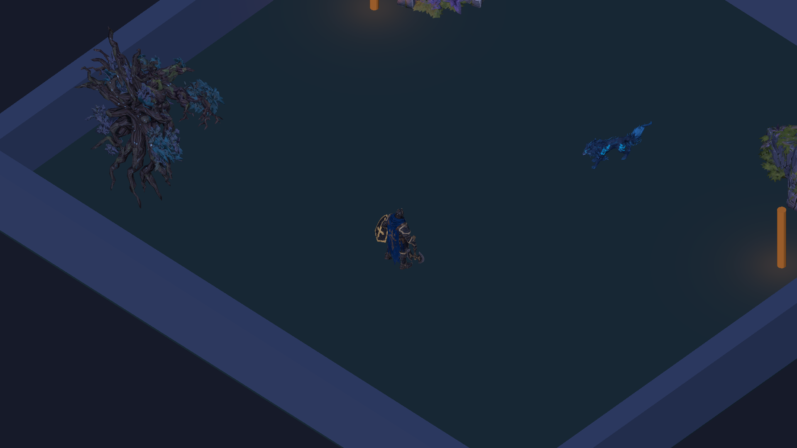
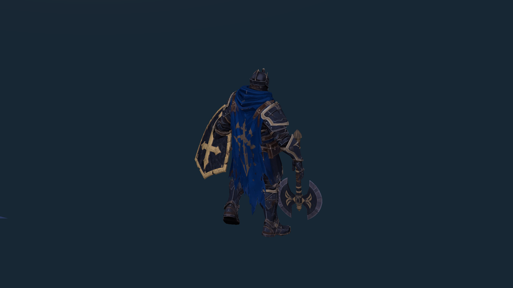

# Integração Meshy — 19/10/2026

Integração técnica dos oito pacotes disponíveis, sobre a fundação `f308604` (PR #10). **Arte e animações não estão aprovadas.** Nenhum sistema de player, câmera, health ou IA foi substituído. Os documentos recebidos foram usados como dados de inspeção; o script de organização do kit não foi executado.

## Conteúdo integrado

| Asset | Entrega nesta branch | Triângulos no Unity |
|---|---|---:|
| Bastião | PF_Bastiao com Avatar Humanoid válido, Walking, machado e escudo nos sockets das mãos | 10.335 |
| Lobo Etéreo | Malha estática sob VisualRoot de PF_LoboEtereo; IA e BiteOrigin existentes | 5.164 |
| Machado | Visual no WeaponSocket/RightHand, sem collider ou dano próprio | 3.131 |
| Escudo | Visual no ShieldSocket/LeftHand, sem collider ou regras novas | 5.000 |
| Árvore | Visual de PF_BosqueArvore_01, orientação/escala revisadas no render | 15.000 |
| Rocha | Visual de PF_BosqueRocha_01 | 6.000 |
| Pilar | Visual de PF_BosquePilar_01 | 8.000 |
| Piso | PF_BosquePiso_01 separado, pronto para posicionamento autoral; não colocado na arena | 3.998 |

Os cinco exports densos somavam **7.900.644 triângulos**, reduzidos para **37.998** pelo Decimate do Blender 4.5.9 LTS. UVs foram mantidos; isso não comprova ausência de artefatos em todos os ângulos. [Medições por asset](optimization.json), [inspeção das fontes/hashes](source-inspection.json), [auditoria de imports Unity](unity-model-audit.txt) e [rig do Bastião](../bastiao/model-audit.txt).

Originais permanecem intactos em Downloads. O Blender portátil foi baixado da [distribuição oficial](https://download.blender.org/release/Blender4.5/), com SHA256 conferido antes da execução, e usado somente na preparação local. Fontes brutas/cache/ferramenta não entram no build. `tools/art/optimize_meshy.py` registra o processamento explícito; Unity não depende de Blender nem de serviço pago para abrir ou compilar.

Oito materiais compartilhados MT_*_Painted usam albedos fornecidos e o shader URP original. Os 31 PNGs originais e oito FBXs são controlados por Git LFS. Imports têm limite de 2048 px, compressão e mipmaps. Metallic/Roughness/Normal foram preservados; não são usados pelo shader pintado atual.

## Problemas encontrados e correções

- Malhas de cenário/escudo tinham entre 480 mil e quase três milhões de triângulos: gerar exports reduzidos antes de usá-las na arena.
- Nomes da coluna do rig do Bastião estavam em ordem inversa: mapeamento Humanoid explícito, Avatar válido/human confirmado na Unity.
- FBXs não carregavam os materiais URP do projeto: desabilitar importação automática de materiais e atribuir albedos/materiais compartilhados nos visuais.
- Origem e escala variavam entre exports: normalizar geometria real, sem usar bounds inflados do SkinnedMeshRenderer. Revisar orientação da árvore e reduzir a escala do Lobo após observar a câmera em Play Mode.
- Sockets técnicos estavam soltos em VisualRoot: preservar seus objetos/referências e prendê-los às mãos do rig. HitOrigin e BiteOrigin continuam independentes de animações; nenhum Animation Event aplica dano.
- Primeiro teste da pausa durante dash observava o estado antes do LateUpdate: corrigir o momento da observação. A execução final passou; a lógica de dash existente não foi alterada.

## Evidências executadas

- Unity **6000.6.6f1 / URP 17.6.0**, scripts compilados sem erros; imports e abertura da cena validados.
- **EditMode: 16/16**, zero falhas — [XML](EditMode.xml). Inclui proteção do gerador, referências da cena, contratos dos prefabs, Avatar/sockets/origem independente, ausência de colliders nos visuais e orçamento de triângulos.
- **PlayMode: 9/9**, zero falhas — [XML](PlayMode.xml). Inclui WASD/rotação/câmera, dash/stamina/cooldown/i-frames/parede, dano único/layers, health, IA/windup/gravidade e testes com os prefabs reais: caminhada acompanha o motor, pausa no dash e ataque/mordida aplicam 25/15 de dano.
- Comparação contra a fundação: **15 verificações** de conteúdo preservado, mais os GUIDs dos cinco prefabs existentes — [registro](preserved-foundation.json). CharacterControllers, BoxColliders de ambiente, componentes de gameplay e os cinco scripts inspecionados permanecem iguais.
- Cena salva permanece byte a byte igual: SHA256 `71ed2d672cbec1b453b07762e7655f04d5d97658ed7c0b7697de418e92747fa8`. Nenhum gerador foi executado para integrar os modelos.
- **Build Windows passou**, 189.330.986 bytes, x64/Mono/D3D11. Executável rodou com smoke aprovado no Xeon E5-2630 v3, RX 580 2048SP e 16.224 MB de RAM: movimento, dash, stamina, i-frames, câmera e render real conferidos. [Captura do executável](windows-runtime.png).
- Reabertura no Editor com gráficos e validação da cena passou. Snapshot externo de **117 arquivos** de cena/prefab/meta permaneceu idêntico após build, execução e reabertura. [Marcadores da execução](evidence.txt).

As imagens são renders da câmera real da cena em Play Mode via URP; não são mockups nem capturas da interface do Editor. A segunda usa enquadramento diagnóstico temporário, sem salvar a cena. O chão e os limites geométricos continuam técnicos. O render não significa que a direção visual de Hades já foi atingida.

## Abrir e testar

1. Usar esta branch sobre a fundação do PR #10. Executar `git lfs install` e `git lfs pull`.
2. Abrir a raiz v2 no Unity Hub com **6000.6.6f1** e Windows Build Support. Aguardar imports; não executar o criador inicial nem os menus de integração sobre os prefabs já preparados.
3. Abrir `Assets/Scenes/Aethel_FirstArena.unity`. Play: WASD/setas, Space/Shift para dash, J/mouse esquerdo para ataque. Conferir Animator, sockets, máscaras de ataque, câmera, origens e valores ao vivo em AethelArtBindings/Inspector.
4. Executar EditMode/PlayMode pelo Test Runner. `Echoes of Aethel > Validate saved arena` valida referências; `Build Windows (preserve content)` gera `Builds/Windows/EchoesOfAethel.exe` e confere hashes de cenas/prefabs/metas.
5. Para smoke do executável: `EchoesOfAethel.exe -aethel-smoke -logFile <arquivo>`. O processo simula movimento/dash, renderiza a câmera e encerra. Não é benchmark ou sessão manual completa.

Relação completa de arquivos: [FILES.txt](FILES.txt). Contrato e troca futura de rig: [ART_INTEGRATION.md](../../engineering/ART_INTEGRATION.md).

## Pendências de validação manual e arte

- Bastião só possui Walking. A apresentação segura um frame ao parar/dar dash/morrer; não há Idle, Attack, Dash, Hit ou Death autorais integrados. Revisar contato dos pés, empunhadura e interseções durante animação; não aprovar combate visual por uma captura estática.
- Lobo ainda desliza com malha estática: faltam rig quadrúpede, locomoção, telegraph, mordida e morte. Windup/dano mecânicos funcionam, mas não têm animação expressiva correspondente.
- Colliders de ambiente foram preservados por contrato. Revisar seu encaixe com tronco, base do pilar e rocha; ajustar somente com decisão explícita de gameplay. Revisar silhuetas/UVs após redução, sombras, contraste e legibilidade em todos os ângulos.
- Piso ainda não foi repetido ou posicionado na arena; validar seams/UVs e colisão antes de trocar o chão técnico. Não existe regeneração automática da arena.
- Sessão manual completa, gamepad e medição sustentada de FPS/frame time/memória continuam pendentes. Execução no hardware-alvo comprova o smoke, não desempenho garantido.
- Nenhum sistema de run/procedural foi adicionado. Três salas autorais continuam sendo o próximo escopo de validação de run após esta base visual.

**Próxima tarefa recomendada:** produzir e integrar rig/animações do Lobo, usando o estado IsWindingUp existente para apresentar o telegraph e preservando a aplicação única de dano em AethelWolfAI. Validar contato de BiteOrigin e esquiva no jogo antes de ampliar salas.
