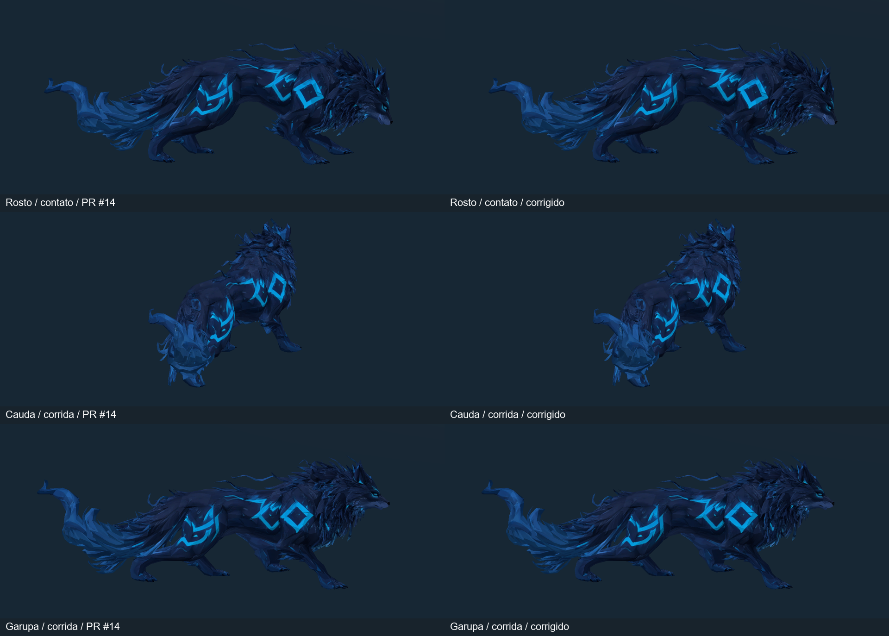

# Lobo Etéreo — correções localizadas das mechas

19/10/2026. Branch `codex/wolf-local-fur-corrections`, baseada em `122a299` / PR #14. Correção geométrica localizada no modelo riggado existente; não é aprovação de arte final ou eliminação de toda interseção em movimento.

## Alteração

- **108 dos 2.590 vértices** (4,17%) receberam offsets de bind, com deslocamento máximo de **18,1 mm**. Foram corrigidas mechas da cauda, bochechas, orelha, juba e garupa; ajustes adicionais tratam encontros durante o ataque/corrida. Os outros 2.482 vértices ficam idênticos.
- [Offsets revisáveis](../../../tools/art/wolf_fur_corrections.json) registram índice, posição original esperada e delta em metros. Não há remesh, remoção de faces, novos vértices ou mudança da ordem de índices. A aplicação recusa topologia/UV incompatível, índice/posição obsoletos, repetição e deslocamentos acima do orçamento de 25 mm.
- A aplicação acontece **depois** da autoria de pesos e poses, somente ao executar explicitamente o script Blender. Normais acompanham a alteração local, conservando as descontinuidades existentes. Limites de bind permanecem iguais, preservando o fit do prefab e o contato das solas.
- **UVs, polígonos, pesos da skin, 24 ossos, hierarquia, bind poses e todos os keyframes permanecem iguais ao PR #14.** Nenhum clip foi retimado; nenhuma curva de animação controla as correções. Não há blend shapes, IK ou sistema novo em runtime.
- FBX riggado e `.blend.zip` atualizados por Git LFS. Modelo estático original, texturas, materiais, Animator Controller, prefab e cena permanecem intactos. A IA e aplicação de dano não foram editadas.

## Medições da superfície

Mesmo auditor do PR #14: nove poses uniformes de cada um dos seis clips, incluindo extremos. A contagem confirma interseções segmento/triângulo após BVH, exclui pares com vértice compartilhado e casos coplanares/extremos de segmento. Toques nas bordas de triângulos podem entrar na contagem; proximidade, espessura e contenção completa não são detectadas. **Pares são diagnóstico geométrico, não número de defeitos visuais independentes.**

| Medida | PR #14 | Revisão |
|---|---:|---:|
| Cruzamentos em repouso | 10 | **0** |
| Pico em Idle / Recovery | 10 / 10 | **0 / 0** |
| Pico em Run | 137 | 126 |
| Média das nove poses de Run | 83,22 | 72,33 |
| Pico em Windup / Bite | 44 / 44 | 28 / 28 |
| Pico em Death | 47 | 33 |

Nenhuma das 54 poses da auditoria aumentou a contagem. Ainda existem cruzamentos no movimento, especialmente em dobras das articulações; zero nos estados indicados vale para essa amostragem e método. Não é garantia de ausência em todos os tempos/ângulos.

[Baseline](baseline.json) · [Revisão](revised.json) · [Deslocamentos e limites](correction-statistics.json) · [Contrato da fonte Blender](source-contract.json) · [Contrato do FBX anterior capturado na Unity](unity-contract.json) · [Import](unity-import.txt) · [Curvas importadas](binding-audit.txt).

O contrato Blender compara topologia, UVs, todos os pesos, esqueleto e curvas dos seis clips entre as duas fontes; verifica que somente os índices declarados mudaram. Na Unity, um teste compara assinaturas das UVs por triângulo, nomes/hierarquia/bind poses e **todas** as curvas importadas com a referência capturada antes da alteração. As UVs são comparadas por triângulo para admitir splits/reordenação de vértices causados pelas normais, sem alterar seu mapeamento.

## Validação executada

- **27/27 EditMode**, zero falhas — [XML](EditMode.xml). Inclui preservação do contrato importado, limites regionais, solas, continuidade, proteção de cena/geradores e toda a suíte anterior. [Estiramento na Unity](unity-stretch.txt) continua dentro dos limites do PR #14. Deslocamento máximo de sola no ataque: **0,394 mm em 204 amostras**, igual à base — [resumo](unity-contact-summary.json).
- **17/17 PlayMode**, zero falhas — [XML](PlayMode.xml). Movimento/dash/stamina, colisões, câmera, deformação real, preparação/telegraph, dano único de 15, invulnerabilidade, saída de alcance, morte e apresentação desativada. O teste de superfície gerou **60 renders URP** por três ângulos.
- **Build Windows aprovado**, x64/Mono/D3D11, **190.733.888 bytes**. Smokes do Lobo e da fundação saíram 0 no **Xeon E5-2630 v3 / RX 580 2048SP / 16.224 MB RAM**. Reabertura do Editor e validação da arena saíram 0. Testes curtos não são benchmark.
- Build conferiu hashes internamente. Snapshot de **127 arquivos de cena/prefab/meta** ficou idêntico nas execuções e reabertura. [Fundação](preserved-foundation.json): 66 arquivos de runtime, prefabs, cenas, Packages e ProjectSettings idênticos ao PR #14. Cena SHA256 `71ed2d672cbec1b453b07762e7655f04d5d97658ed7c0b7697de418e92747fa8`. [Marcadores](evidence.txt).

À esquerda, capturas PlayMode do PR #14 preservadas antes da nova execução; à direita, versão corrigida. A prancha recorta bordas vazias, redimensiona e adiciona legendas; não retoca a malha/textura. São renders da câmera, não capturas da interface do Editor ou imagens geradas por IA.

[Lado direito em movimento](run-view-0.gif) · [Lado esquerdo em movimento](run-view-1.gif) · [Traseira em movimento](run-view-2.gif). Cada GIF reproduz oito poses URP em 50 ms por quadro, representando o ciclo Run de 0,4 s; não é gravação contínua. [Telegraph em PlayMode](windup-runtime.png) · [Contato em PlayMode](bite-runtime.png) · [Windup Windows](windows-windup.png) · [Contato Windows](windows-bite.png).

## Abrir e testar

1. `git lfs install` / `git lfs pull`; abrir a raiz v2 no **Unity 6000.6.6f1 / URP 17.6.0** e a cena `Assets/Scenes/Aethel_FirstArena.unity`. Não recriar a arena nem reintegrar o prefab.
2. Em Play, usar WASD, Space/Shift e J/mouse esquerdo. Afastar-se para ver a passada e aproximar-se para preparação/telegraph/mordida. Conferir mechas da cauda e rosto, encontros do pelo com as pernas e transições.
3. Rodar EditMode/PlayMode no Test Runner. `LocalFurEditsPreserveImportedUvRigAndEveryAnimationCurve` verifica a preservação no FBX importado. A suíte anterior mantém os testes de solas, continuidade, movimento/dash, colisões, câmera, IA e dano.
4. O teste de superfície existente captura Run/Windup/Bite/Death por três ângulos na URP real, com enquadramento temporário e sem salvar a cena. `Build Windows (preserve content)` confere hashes; Development build aceita separadamente `-aethel-wolf-smoke` e `-aethel-smoke`.
5. Fonte: Blender 4.5.9 LTS, `--background --factory-startup --python-exit-code 1 --python tools/art/rig_wolf.py`, na raiz, recria explicitamente os exports. Preservar edições manuais antes de rodar. Depois usar o refresh explícito da Unity. Nunca ocorre geração durante import, compilação ou build.
6. `verify_wolf_fur_contract.py -- <base.blend> <revisado.blend> <relatorio.json>` executado pelo Blender confere a preservação da fonte. `audit_wolf_surface.py -- <relatorio.json>` audita o `.blend` aberto; `python tools/art/check_wolf_polish.py` compara a fundação ao PR #14.

O arquivo `unity-contract.json` é a referência anterior à correção; não substituí-lo pelo export corrigido. A captura explícita recusa sobrescrever essa referência.

## Limites e próxima tarefa

Faltam aprovação artística com controle físico, revisão prolongada de dobras em movimento e perfil com vários inimigos. Próxima tarefa recomendada: corretivos específicos das articulações para os encontros restantes, usando esta auditoria como base e mantendo a aplicação de dano na IA. Não há SFX/VFX novo, terreno irregular ou expansão roguelite nesta entrega.

Arquivos alterados: [FILES.txt](FILES.txt).
