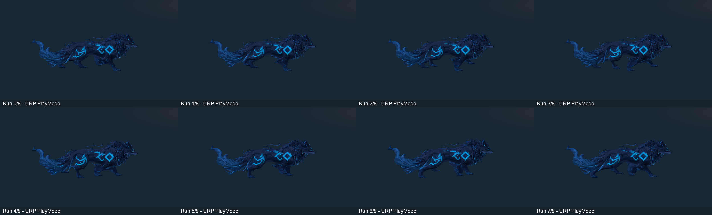
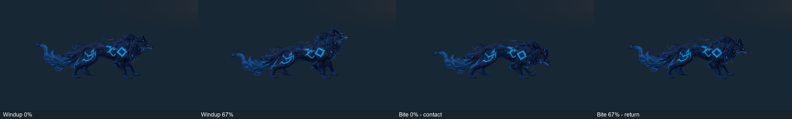

# Lobo Etéreo — polimento de patas, skin e ritmo

19/10/2026. Branch `codex/wolf-paws-skin-polish`, baseada em `9cd4a24` / PR #12. Revisão dos assets existentes; não representa aprovação de arte final.

## Alterações

- As quatro cadeias foram ajustadas à postura **assimétrica** da malha Meshy. A pata traseira esquerda atravessa o plano central; classificá-la apenas pelo sinal de X atribuía seus vértices ao lado errado.
- Pesos das solas são rígidos, com transições suavizadas pela topologia nas articulações. A cabeça é classificada antes das pernas, impedindo que o queixo siga uma pata. A transição cauda/garupa deixa de depender de um corte abrupto por altura. Continuam 24 ossos, 2.590 vértices de autoria, 5.164 triângulos e até quatro influências normalizadas.
- Um solver de duas articulações **somente no Blender** mantém os apoios enquanto o tronco se move. O resultado é exportado como keyframes FK, sem constraints, IK de runtime ou novos componentes. O polo dianteiro estável evita um flip de joelho observado entre amostras na Unity.
- Corrida diagonal passa de 0,4667 para **0,4 s por ciclo**. O trecho de apoio compensa 3 m/s, velocidade existente da IA, e o balanço usa uma curva Hermite com velocidade contínua nos contatos. Elevação de 10,5 cm durante o balanço e oscilação menor do tronco substituem a rotação senoidal livre das patas.
- Preparação concentra a carga nos primeiros 60% e o avanço nos últimos 32% do clip. A apresentação continua amostrada pelo windup mecânico de **0,45 s**. Mordida continua com **0,2 s**, começando na conclusão do windup; recuperação deixa de introduzir um segundo agachamento depois do retorno. Não há Animation Events.
- Export a **60 Hz**, durações de ataque preservadas. O refresh explícito acompanha os intervalos dos takes, conservando nomes, IDs e configurações dos clips. Não há hook de import, compilação, carregamento ou build que regrave conteúdo.
- FBX riggado e `.blend.zip` atualizados em Git LFS. Malha estática original, UVs, texturas, material, Animator Controller, prefab, IA e todos os scripts de runtime permanecem preservados.

## Medições reproduzíveis

`tools/art/audit_wolf_motion.py` avalia as mesmas regiões geométricas de sola e as mesmas arestas nas duas fontes, a 30 Hz. Baseline extraída do `.blend.zip` de `9cd4a24`, sem alterar o original. Os valores de sola são **centroides de regiões**, não uma prova de que todo vértice toca o chão.

| Medida na fonte Blender | PR #12 | Revisão |
|---|---:|---:|
| Desvio médio de apoio por amostra, com avanço de 3 m/s | 70,97 mm | < 0,001 mm |
| Altura mínima do centro de sola em Windup | −156,40 mm | +9,22 mm |
| Estiramento máximo de aresta em Run | 27,76× | 5,28× |
| Percentil 99 do estiramento em Run | 1,789× | 1,714× |
| Percentil 99 do estiramento em Windup | 1,494× | 1,186× |

[Baseline](baseline.json) · [Revisão](revised.json) · [Geração](rig-generation.json) · [Import Unity](unity-import.txt) · [Curvas importadas](binding-audit.txt).

O resultado ideal do solver na fonte não substitui o teste do FBX importado: os testes Unity amostram a malha deformada, incluem tempos entre keys, conferem apoio da corrida, estabilidade das quatro solas no ataque e continuidade Windup→Bite, Bite→Recovery e do loop Run. A cena da arena também é exercitada com a IA real.

## Evidências executadas

- **24/24 EditMode**, zero falhas — [XML](EditMode.xml). Inclui apoio da corrida compensando avanço, quatro solas no ataque e continuidade da skin nos encontros dos clips; toda a suíte anterior foi mantida. Nas 204 amostras das solas em Windup/Bite/Recovery, o maior deslocamento importado foi **0,394 mm** — [resumo](unity-contact-summary.json), [amostras](unity-sole-samples.txt).
- **16/16 PlayMode**, zero falhas — [XML](PlayMode.xml). IA real, deformação da malha, telegraph, ausência de dano antecipado, aplicação única de 15, invulnerabilidade, saída de alcance, morte e apresentação desativada; inclui sequência lateral URP da revisão final.
- **Build Windows aprovado**, x64/Mono/D3D11, **190.733.887 bytes**. Smokes `-aethel-wolf-smoke` e `-aethel-smoke` saíram com código 0 no **Xeon E5-2630 v3 / RX 580 2048SP / 16.224 MB RAM**. Não é medição de FPS sustentado.
- **Reabertura do Editor e validação da arena aprovadas**, saída 0, sem erro de compilação. Snapshot de **127 arquivos de cena/prefab/meta** idêntico depois das execuções e reabertura; build também verificou hashes internamente. [Marcadores](evidence.txt).
- [Preservação da fundação](preserved-foundation.json): **66 arquivos** de runtime, prefabs, cenas, Packages e ProjectSettings idênticos ao PR #12. IA, dano e física permanecem iguais; cena SHA256 `71ed2d672cbec1b453b07762e7655f04d5d97658ed7c0b7697de418e92747fa8`.

As pranchas apenas organizam e redimensionam renders reais, sem retoque da malha. [Windup em jogo](windup-runtime.png) · [Contato em jogo](bite-runtime.png) · [Windup no executável Windows](windows-windup.png) · [Contato no executável Windows](windows-bite.png). Não são mockups ou imagens geradas por IA, nem capturas da interface do Editor; são renders das câmeras durante os testes Unity e do executável.

## Abrir e testar

1. `git lfs install` e `git lfs pull`. Abrir a raiz v2 no Unity **6000.6.6f1 / URP 17.6.0**.
2. Abrir `Assets/Scenes/Aethel_FirstArena.unity` e Play. Usar WASD, Space/Shift para dash e J/mouse esquerdo para ataque. Observar a passada diagonal ao afastar-se do Lobo; aproximar-se para ver preparação, aviso, mordida e pausa de recuperação.
3. Rodar EditMode e PlayMode no Test Runner. `WolfRigTests` verifica os apoios na skin importada; `WolfVisualTests` cobre o combate e captura uma sequência lateral pela câmera URP. As capturas usam enquadramento temporário, sem salvar a cena.
4. `Echoes of Aethel > Build Windows (preserve content)` verifica hashes das cenas/prefabs/metas. No executável Development, rodar separadamente `-aethel-wolf-smoke` e `-aethel-smoke` para regressão automatizada; as flags são opcionais e não atuam no lançamento normal.
5. Para autoria local: Blender 4.5.9 LTS, `--background --factory-startup --python-exit-code 1 --python tools/art/rig_wolf.py`, a partir da raiz. Esse comando recria explicitamente as saídas; preservar edições manuais antes de rodá-lo. Depois usar `Art > Refresh wolf rig export fit (explicit)`. Não reintegrar o prefab nem recriar a arena.
6. Auditoria da fonte: abrir `.bootstrap/LoboEtereo_Rig.blend` no Blender em background e executar `--python tools/art/audit_wolf_motion.py -- <relatorio.json>`. `python tools/art/check_wolf_polish.py` confere a preservação em relação ao PR #12.

## Limites e próxima tarefa

Ainda há estiramento localizado em triângulos do pelo: o máximo não equivale ao comportamento da maior parte da superfície, mas continua registrado para revisão. A malha de origem não tem uma pose de bind simétrica. Não foram refeitos topologia, UVs ou textura; o polimento é dos pesos e clips. Não há adaptação a terreno inclinado ou irregular, nem novos SFX/VFX.

Faltam aprovação artística com controle físico, inspeção prolongada de interseções em todos os ângulos e perfil com vários inimigos; testes curtos não são benchmark. Próxima tarefa recomendada: revisão artística da garupa/pelo e silhueta em movimento, seguida de efeitos de impacto sincronizados ao contato já existente. Bastião e expansão roguelite ficam fora deste PR.

Arquivos alterados: [FILES.txt](FILES.txt).
