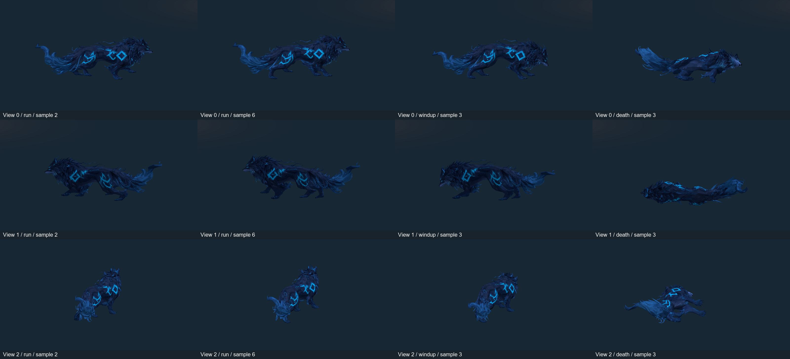

# Lobo Etéreo — garupa, pelo e interseções em movimento

19/10/2026. Branch `codex/wolf-haunch-fur-review`, baseada em `840dc6a` / PR #13. Revisão da skin e do espaço de balanço das pernas, mantendo o mesmo rig e a arquitetura existente. Não é aprovação de arte final nem eliminação de todas as interseções.

## Problemas e correções

- Pesos das patas/canelas alcançavam mechas superiores da garupa e da juba. Essas influências agora são transferidas suavemente para a articulação superior da mesma cadeia; o movimento da coxa é conservado. Solas, mandíbula e orelhas mantêm seus controles.
- A suavização uniforme tratava uma aresta longa do pelo como sua base estreita. A revisão mistura vizinhança uniforme com ponderação pela distância, dando mais coerência às mechas estreitas e preservando transições de volume.
- No clip Run, a trajetória muito recolhida aproximava patas e pelo do corpo. O balanço fica 35 mm mais baixo, com pequena abertura lateral (25 mm dianteira / 45 mm traseira) e avanço do centro de apoio. A compensação de 3 m/s, o ciclo de 0,4 s e o apoio no chão continuam sujeitos aos testes anteriores.
- Export FK a 60 Hz, 24 ossos, 2.590 vértices de autoria, 5.164 triângulos, até quatro influências. Nenhuma alteração de topologia, UV, textura, material, esqueleto ou duração dos clips. Nenhum IK ou sistema de controle novo em runtime.
- Windup/Bite/Recovery/Death conservam seus keyframes. IA, dano, física, prefab, Animator Controller e cena continuam iguais ao PR #13. O contato mecânico de 0,45 s, mordida visual de 0,2 s e aplicação única de 15 não mudam.

## Auditoria da superfície

`tools/art/audit_wolf_surface.py` avalia nove poses uniformes de cada um dos seis clips, incluindo os extremos. Usa BVH para candidatos e confirma interseção segmento/triângulo no interior do segmento. Exclui pares que compartilham vértice, hits nos extremos do segmento e pares coplanares. Toques em bordas de triângulos podem permanecer na contagem; não detecta espessura, proximidade ou contenção completa. **Contagens são pares de triângulos para diagnóstico, não número de defeitos visuais independentes.**

As duas fontes usam a mesma topologia e amostragem. A base é uma cópia do `.blend` do PR #13 antes das alterações. A malha em repouso possui dez cruzamentos; eles continuam registrados, e os pares ausentes no repouso são contados separadamente por pose.

| Medida na fonte | PR #13 | Revisão |
|---|---:|---:|
| Pico de pares cruzados em Run | 151 | 137 |
| Média de pares cruzados nas nove amostras Run | 99,00 | 83,22 |
| Pico de pares cruzados em Windup | 51 | 44 |
| Pico de pares cruzados em Bite | 47 | 44 |
| Pico de pares cruzados em Death | 49 | 47 |
| Máximo de estiramento de aresta na garupa, Run | 4,93× | 3,37× |
| Percentil 99 da garupa, Run | 1,43× | 1,48× |
| Máximo da garupa, Windup/Bite | 2,10× | 1,37× |
| Máximo da juba, Run | 5,28× | 4,57× |
| Máximo da garupa, Death | 2,29× | 2,23× |

O percentil 99 da garupa em Run aumentou ligeiramente. As mechas ainda apresentam deformação e cruzamentos residuais; os picos menores não substituem a aprovação visual. Idle e Recovery mantêm os dez pares já presentes no repouso.

[Baseline por pose/região](baseline.json) · [Revisão por pose/região](revised.json) · [Geração do rig](rig-generation.json) · [Import Unity](unity-import.txt) · [Curvas importadas](binding-audit.txt).

## Validação executada na Unity

- **26/26 EditMode**, zero falhas — [XML](EditMode.xml). Pesos superiores sem influência de patas/canelas, limites regionais na malha importada, apoios das solas, continuidade de clips e toda a suíte anterior. [Máximos medidos na Unity](unity-stretch.txt): Run garupa 3,373738× / juba 4,570235×; Windup/Bite garupa 1,372498×. Deslocamento máximo de sola no ataque **0,394 mm em 204 amostras**, igual ao PR #13 — [resumo](unity-contact-summary.json).
- **17/17 PlayMode**, zero falhas — [XML](PlayMode.xml). Regressão de movimento, dash, stamina, colisões, câmera, IA e dano; windup/telegraph, mordida única de 15, invulnerabilidade, saída de alcance, morte, apresentação desativada e captura de superfície.
- **60 renders URP** de Run/Windup/Bite/Death, por três ângulos, capturados pelo novo teste. As sequências abaixo usam oito poses da corrida em 50 ms por quadro, representando o ciclo de 0,4 s; são reprodução amostrada das capturas, não gravação contínua. Prancha apenas organiza/redimensiona os renders; não há retoque da malha ou imagem gerada por IA. Enquadramento diagnóstico temporário, sem salvar a cena.
- [Contrato da fonte](source-contract.json): assinaturas de vértices, polígonos, UVs e esqueleto idênticas ao PR #13; poses de Idle/Windup/Bite/Recovery/Death idênticas nas nove amostras por clip. [Fundação](preserved-foundation.json): 66 arquivos de runtime, prefabs, cenas, Packages e ProjectSettings preservados. FBX estático original intacto.
- **Build Windows aprovado**, x64/Mono/D3D11, **190.733.888 bytes**; smokes do Lobo e da fundação saíram 0 no Xeon E5-2630 v3 / RX 580 2048SP / 16.224 MB RAM. Reabertura do Editor e validação da arena saíram 0. **127 arquivos de cena/prefab/meta** permaneceram idênticos nas execuções e reabertura; build também conferiu hashes internamente. [Marcadores](evidence.txt). Cena SHA256 `71ed2d672cbec1b453b07762e7655f04d5d97658ed7c0b7697de418e92747fa8`.

[Lado direito em movimento](run-view-0.gif) · [Lado esquerdo em movimento](run-view-1.gif) · [Traseira em movimento](run-view-2.gif) · [Telegraph em jogo](windup-runtime.png) · [Contato em jogo](bite-runtime.png).

Capturas do executável Windows: [windup](windows-windup.png) · [contato](windows-bite.png). Nenhuma captura pretende representar a interface do Editor.

## Reproduzir na Unity e na fonte

1. `git lfs install` / `git lfs pull`; abrir a raiz v2 no **Unity 6000.6.6f1 / URP 17.6.0** e a cena `Assets/Scenes/Aethel_FirstArena.unity`. Não executar o criador inicial nem reintegrar o prefab.
2. Em Play, afastar-se do Lobo para ver a passada; aproximar-se para telegraph e mordida; usar WASD, Space/Shift e J/mouse esquerdo para a regressão de combate.
3. Rodar EditMode/PlayMode no Test Runner. `UpperFurHasNoPawOrLowerLegInfluence` verifica os pesos importados; `ImportedHaunchAndManeStayInsideReviewedStretchLimits` amostra a malha em quatro clips. Os testes anteriores continuam verificando solas, loop, continuidade, IA e dano.
4. `CaptureHaunchAndFurFromBothSidesAndRear` renderiza Run/Windup/Bite/Death por três ângulos temporários, pela URP real. Não salva a cena e não dirige o combate.
5. `Echoes of Aethel > Build Windows (preserve content)` verifica hashes. No Development build, rodar separadamente `-aethel-wolf-smoke` e `-aethel-smoke` para regressão automatizada; o lançamento normal não ativa esses diagnósticos.
6. Blender 4.5.9 LTS: `--background --factory-startup --python-exit-code 1 --python tools/art/rig_wolf.py`, a partir da raiz, recria explicitamente FBX e `.blend.zip`. Preservar edições artísticas manuais antes de rodar. Depois usar o refresh explícito do export na Unity; não há geração durante import/compilação/build.
7. Para a auditoria, abrir o `.blend` fora de Assets e executar `--python tools/art/audit_wolf_surface.py -- <relatorio.json>`. `python tools/art/check_wolf_polish.py` compara a fundação ao PR #13.

## Limites e próxima tarefa

Ainda falta aprovação artística com controle físico e combate prolongado. Interseções residuais da fonte exigem edição localizada das mechas/topologia ou corretivos artísticos, preservando UVs e o contrato do rig; essa é a próxima tarefa recomendada. Não há adaptação a terreno irregular, SFX/VFX novo ou expansão roguelite. Testes curtos não são benchmark com vários inimigos.

Arquivos alterados: [FILES.txt](FILES.txt).
