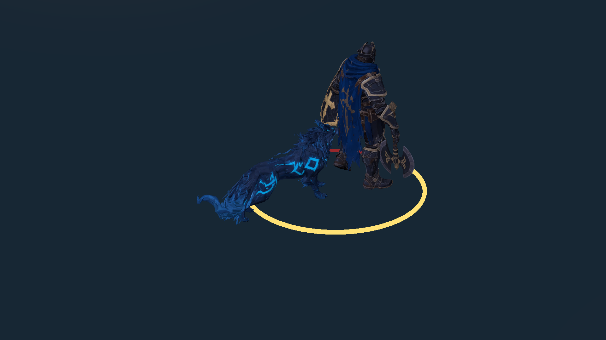

# Lobo Etéreo — rig, animações iniciais e telegraph

19/10/2026. Branch `codex/wolf-rig-telegraph`, baseada em `7323996` / PR #11. Entrega técnica de um rig quadrúpede e seis clips FK iniciais; **não é aprovação de animação/arte final**. O modelo estático original e as texturas permanecem intactos.

## Implementação

- `MD_LoboEtereo_Rigged.fbx`: 24 ossos, 5.164 triângulos, todos os 2.590 vértices de autoria com skin, até quatro influências. Rig, pesos e keyframes foram criados localmente por `tools/art/rig_wolf.py` no Blender 4.5.9 LTS. Não foram baixados clips de terceiros nem usadas APIs/credenciais pagas.
- Fonte editável em `Assets/Art/Models/Source/LoboEtereo_Rig.blend.zip`, por Git LFS. Descompactar fora de Assets para editar no Blender; texturas são compartilhadas pelo material Unity, sem PNGs duplicados no arquivo de autoria. Unity/build não dependem do Blender.
- Avatar **Generic válido**, Animator Controller com Idle, Run, Windup, Bite, Recovery e Death; root motion desligado. Idle/Run são loops; demais clips não são loops. Todos têm zero Animation Events.
- `AethelWolfVisual`, em VisualRoot, lê a IA e health existentes. Não escolhe alvos, move CharacterController, altera stamina/health ou aplica dano. A IA recebeu somente seis propriedades de leitura; seus métodos e campos de combate não mudaram.
- Windup é amostrado pelo progresso real da IA: o clip de 14/30 s acompanha o prazo mecânico de **0,45 s**, sem criar outro timer de ataque. Bite começa quando a IA termina o windup, inclusive no golpe que mata o jogador. Recovery acompanha o prazo existente; a corrida pode aparecer durante recuperação se a IA continuar perseguindo, conservando esse comportamento.
- O telegraph tem contorno fixo e arco de progresso claro, usando shader URP original e LineRenderers sem colliders. Seu centro acompanha a projeção de BiteOrigin e o raio vem de BiteRadius. É uma indicação de contato no chão; não substitui a verificação 3D de alcance/layer/cápsula da IA.
- Telegraph é ocultado em contato, morte do Lobo, morte do alvo e desativação da apresentação/IA. O comportamento existente de manter windup pendente quando o alvo morre foi preservado; a apresentação não mostra um ataque ativo nesse caso.
- CharacterController, AethelHealth, campos da IA, BiteOrigin em `VisualRoot` e GroundCheck na raiz foram preservados. BiteOrigin não foi preso à mandíbula; a animação não redefine a consulta de dano. O prefab mantém seu GUID. A cena não foi regenerada nem regravada.

| Clip | Duração da fonte | Uso |
|---|---:|---|
| Idle | 2,0 s | respiração e cauda |
| Run | 14/30 s | passada diagonal, flexão das pernas, oscilação do corpo |
| Windup | 14/30 s | preparação, mandíbula e avanço de contato; sincronizado com o prazo da IA |
| Bite | 0,2 s | contato e retorno inicial; sem evento de dano |
| Recovery | 26/30 s | retorno à postura, amostrado pelo prazo da IA |
| Death | 1,0 s | queda lateral, mantendo física/morte existentes |

## Problemas encontrados e resolvidos

1. Escalas herdadas do parent Meshy e export FBX por objeto deixavam skin/ossos em unidades incompatíveis. A fonte agora considera a matriz mundial completa e exporta com `FBX_SCALE_ALL`; a malha de bind chega com altura de 0,9 m, sem ocultar o erro por uma escala extrema do prefab.
2. Animator Generic veio com `CullUpdateTransforms`: o teste detectou tempo/ossos parados fora da câmera. Prefab usa **AlwaysAnimate**, confirmado por teste e pela diferença de vértices em execução. O custo de muitos inimigos ainda precisa de perfil; esta arena tem um Lobo.
3. Ajustar pela pose selecionada do FBX deslocava os pés. O fit agora usa a geometria de bind, e um teste amostra Idle e confere os pés junto à origem visual.
4. A ferramenta antiga de fit estático poderia girar o novo rig. Ela passa a recusar o prefab riggado. A integração inicial também recusa repetição antes de modificar imports; revisões do export têm um comando explícito separado.

## Validação executada

- **22/22 EditMode** — [XML](EditMode.xml). Avatar/skin/clips, pesos, ausência de eventos de dano, escala, pés, shell físico, refs do telegraph e proteção das ferramentas, além de toda a suíte anterior.
- **15/15 PlayMode** — [XML](PlayMode.xml). Toda a regressão anterior mais seis testes do Lobo: deformação real da malha na corrida; windup/aviso/contato/recuperação/morte; apresentação desativada sem cancelar dano; invulnerabilidade; saída de alcance; alvo morto e mordida letal. Contato aplica **15 uma única vez**, e o dano de antecipação continua zero.
- Comparação contra PR #11: **16 verificações** de preservação — [registro](preserved-foundation.json). IA idêntica após excluir apenas os getters de leitura; Update/aplicação de dano intactos. Player, health, câmera, gerador, cena, demais prefabs e FBX estático original continuam iguais.
- **Build Windows passou**, x64/Mono/D3D11, 190.306.431 bytes. Smoke específico do Lobo aprovado no Xeon E5-2630 v3 / RX 580 2048SP / 16.224 MB RAM: deformação da mandíbula, windup, aviso, mordida e dano único. Smoke anterior de movimento/dash também aprovado, ambos com saída 0.
- Build verificou hashes antes/depois; snapshot de **127 arquivos de cena/prefab/meta** permaneceu idêntico na execução e reabertura no Editor. Cena segue com SHA256 `71ed2d672cbec1b453b07762e7655f04d5d97658ed7c0b7697de418e92747fa8`.
- [Geração do rig](rig-generation.json), [import Unity](unity-import.txt), [amostragem dos clips/ossos](binding-audit.txt) e [marcadores de build/execução](evidence.txt).

[Corrida](run-runtime.png) · [Contato](bite-runtime.png) · [Morte](death-runtime.png). Imagens da câmera URP real durante os testes em PlayMode, em enquadramento diagnóstico temporário; não são mockups nem imagens geradas por IA. A cena não foi salva por essas capturas.

Capturas do executável Windows: [windup](windows-windup.png), [mordida](windows-bite.png) e [arena no smoke anterior](windows-arena.png).

## Abrir e reproduzir

1. `git lfs install` e `git lfs pull`; abrir a raiz v2 com **Unity 6000.6.6f1 / URP 17.6.0**.
2. Abrir `Assets/Scenes/Aethel_FirstArena.unity` e Play. Aproximar-se do Lobo, observar preparação e arco; sair do alcance ou dar dash para evitar contato. WASD/setas, Space/Shift e J/mouse esquerdo permanecem iguais.
3. No prefab PF_LoboEtereo, conferir Animator Generic em Model_LoboEtereo, root motion desligado, AlwaysAnimate, AethelWolfVisual em VisualRoot, linhas de aviso, BiteOrigin e máscaras existentes. AethelArtBindings mostra fase/progresso ao vivo no Inspector.
4. Rodar EditMode/PlayMode pelo Test Runner. `Echoes of Aethel > Build Windows (preserve content)` gera o executável e verifica hashes de cenas/prefabs/metas.
5. Builds de desenvolvimento aceitam `-aethel-wolf-smoke -logFile <arquivo>` para posicionar os atores em uma configuração diagnóstica, conferir mandíbula, aviso, contato e dano único e gravar duas imagens ao lado do executável. Rodar separado do smoke anterior `-aethel-smoke`. Sem essas flags, o diagnóstico não altera o jogo.

Não executar o criador inicial nem reintegrar o prefab pronto. Para editar a fonte, descompactar `.blend.zip` fora de Assets, editar rig/ações e exportar explicitamente. O script de autoria recria suas saídas; preservar edições artísticas manuais antes de executá-lo novamente. `Art/Refresh wolf rig export fit (explicit)` reimporta o export e ajusta somente o visual.

Arquivos modificados: [FILES.txt](FILES.txt).

## Limites e próxima revisão

Clips FK e pesos iniciais precisam de avaliação manual de passada, contato das patas, deformação de pelo/mandíbula, interseções e ritmo. Não há IK de terreno, clip de hit, SFX ou VFX de impacto novo. A indicação no chão foi validada na arena plana atual; pisos inclinados/irregulares exigem projeção própria. Ainda faltam revisão com controle físico, combate prolongado e perfil sustentado de CPU/GPU com vários inimigos. Smoke não é benchmark.

O Bastião continua com Walking apenas, e a composição/iluminação final do Bosque não está aprovada. Não foram adicionados sistemas de run ou novas salas. Próxima tarefa recomendada: revisão manual do skin e das patas do Lobo no jogo, antes de polir efeitos de impacto e avançar aos clips de combate do Bastião.
